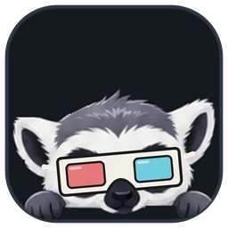

<h1 align="center">Lemio Together</h1>

Gledaj filmove i serije s Markom, u istoj sekundi, svatko na svom kompjuteru.

---

Lemio Together je mali Windows program za zajedničko gledanje. Marko pusti film u svom Lemiju, a kod tebe se otvori isti film, na istom mjestu. Kad netko pauzira, pauzira se svima; kad netko premota, svi idu za njim. Razgovarate na Discordu kao i inače.

Usput možeš predlagati što gledati dalje, dati +1 tuđem prijedlogu, pregledavati filmove i serije dok film ide u kutu, i obući svog lemura.

## Instalacija

1. Otvori [Releases](../../releases/latest) i skini `Lemio-Together_…_x64-setup.exe`.
2. Pokreni ga. Windows će reći da je program nepoznat: klikni **More info**, pa **Run anyway**. Program nije potpisan certifikatom koji Microsoft prodaje, zato pita.
3. Gotovo. Lemio Together je u Start meniju.

## Ulazak u sobu

Marko ti pošalje link sobe, nešto kao `lemio-together://join?room=popcorn-lemur-42&key=…`.

- **Klikni ga** i Lemio Together se otvori ravno u sobi. Ako Discord ne napravi link od njega, kopiraj ga i zalijepi u polje za sobu.
- Ili samo **upiši ime sobe** (`popcorn-lemur-42`).

Sobe u kojima si bio ostaju zapamćene, pa sljedeći put samo klikneš Play na kartici.

## Naslovi i slike

Imena filmova, posteri i logotipi dolaze s TMDB-a, za što treba ključ. Marko ga stavlja u link sobe i Lemio Together ga zapamti sam. Ako ga pošalje odvojeno, zalijepi ga u **Settings → TMDB key**. Bez njega gledanje u sobi radi, samo Discover i slike ostaju prazni.

## Nova verzija

Lemio Together se ažurira sam. Kad izađe nova verzija, lemur ti mahne i pita: klikni **Update** i to je to.

## Pitanja

Pitaj Marka.
